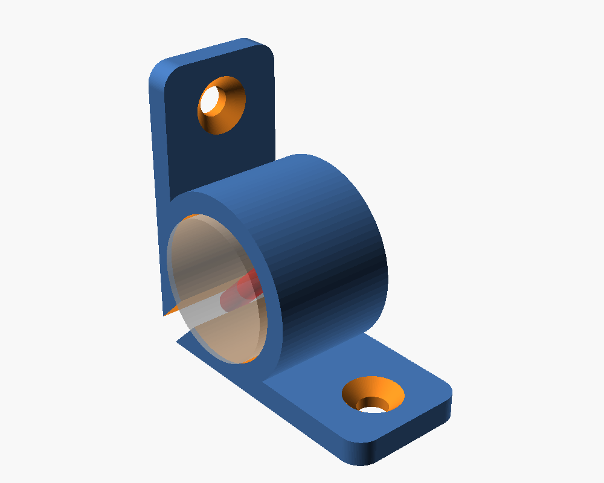
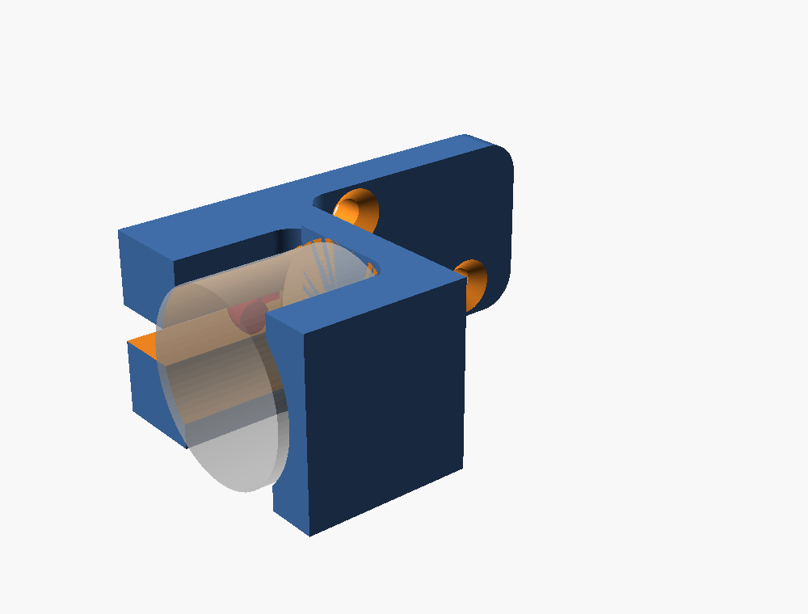
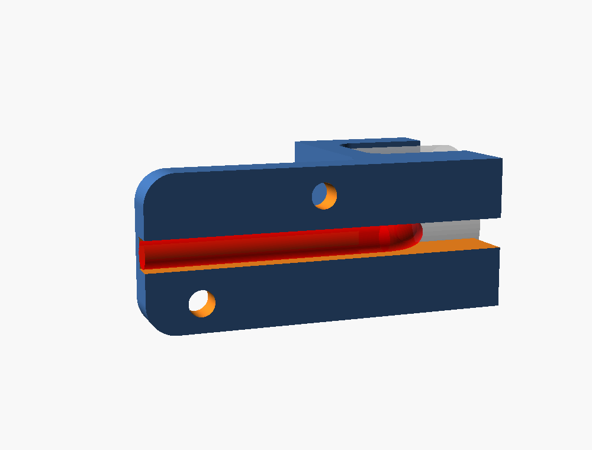

# BR-20/15 electromagnet mounts for campervan cabinets

Two parametric OpenSCAD designs for the 12 V [BR-20/15 holding electromagnet](#electromagnet)
(20 mm diameter, 15 mm long, M3 thread in the back, lead exiting from the side).
Open a `.scad` file in OpenSCAD and use the Customizer panel to tweak sizes.

| Corner mount (doors) | Flat drawer mount (drawers) |
|---|---|
|  |  |

Renders use `part = "model"` and `show_magnet = true`: the translucent cylinder
is the magnet and the red rod is its lead.

| File | Use | Footprint (defaults) |
|---|---|---|
| `corner_mount.scad` | Cabinet doors: sits in the inside corner between side panel and shelf/top | 40.6 x 40.6 mm, 18 mm deep |
| `drawer_mount.scad` | Drawers: screws flat onto the cabinet side panel, nothing taller than the magnet | 30 mm wide, 20 mm tall, 49 mm deep |

Ready-to-print STLs: `corner_mount.stl`, `drawer_mount_left.stl`, `drawer_mount_right.stl`.

## Electromagnet

The designs are sized for the BR-20/15 energise-to-hold electromagnet with an
M3 rear thread. Product page with specs:
[DomoticX: Elektromagneet 12V 2.5KG 20x15mm BR-20/15, M3](https://domoticx.net/webshop/elektromagneet-12v-25kg-20x15mm-hoog-br-2015-bevestiging-m3/).

| Spec | Value |
|---|---|
| Voltage | 12 V DC |
| Power | 2 W (200-250 mA) |
| Holding force | 2.5 kg |
| Body | 20 mm diameter, 15 mm high |
| Lead | 200 mm |
| Mounting | M3 threaded hole in the back |

The same magnet is also sold with an
[M4 thread](https://domoticx.net/webshop/elektromagneet-12v-25kg-20x15mm-hoog-br-2015-bevestiging-m4/).
That one fits the same pocket. Set `rear_screw_d = 4.5` and use an M4 screw.
The generic version of this part is often listed as P20/15. Check the diameter,
height and thread size before you buy.

## Corner mount

* Pocket holds the magnet with 0.3 mm radial clearance; the magnet face sits
  1 mm proud of the mount so the door (or its striker plate) always hits steel first.
* The magnet is fixed from behind with an M3 screw through the back plate
  (screw length = 4 mm back plate + thread depth in the magnet, typically M3x8).
* The cable slot points into the corner. The lead bends 90 degrees in the slot
  and runs along the corner through the back of the mount towards the rear of
  the cabinet, where you route it to the switch/relay.
* Two flanges with countersunk holes for 3.5-4 mm wood screws: one lies on the
  shelf, one against the side panel. Both screws are driven from the front.
* The part is symmetric about its diagonal, so the same print fits all four
  corners of a door opening.

## Flat drawer mount

* All material stays inside the 20 mm vertical envelope of the magnet, so it
  fits where there is no height to spare (drawer slide above, drawer side below).
* The magnet is held by two side cradles (wall side and drawer side), a back
  plate with the M3 rear screw, and a 30 mm mounting tab that runs along the
  cabinet side panel behind the magnet.
* The lead exits towards the wall into a 4 mm channel cut through the wall-side
  cradle, bends backwards in the 7 mm gap between magnet and wall, passes a notch
  in the back plate and runs in a 3 mm deep groove on the wall side of the tab.
  Nothing of the cable is exposed on the drawer side.
* Two countersunk holes for 3 mm wood screws, staggered above and below the
  cable groove.
* Default is for the LEFT cabinet wall (wall on the left of the magnet when
  viewed from the front, as in the photo). Set `mirror_for_right_wall = true`
  for the right-hand wall.

## Assembly

1. Rotate the magnet so the lead points to the slot/channel, bend the lead
   90 degrees backwards about 6 mm from the body.
2. Slide the magnet into the mount from the front with the lead trailing in
   the slot, then fix it with the M3 screw from behind.
3. Screw the mount to the cabinet. Check the magnet face is flush with or a
   little in front of the door/drawer front contact face.
4. Fit the steel striker plate on the door or drawer so it lands flat on the
   magnet face. Any air gap costs most of the holding force.

## Printing

* `part = "print"` (default) already lays each part in its print orientation:
  corner mount on its back face, drawer mount on its flat side. No supports.
* PETG or ABS/ASA recommended (the van gets hot, PLA creeps). 3-4 perimeters,
  0.2 mm layers.
* `fit` controls the pocket clearance: 0.3 mm is a light press fit on most
  printers, raise it to 0.4 if the magnet will not slide in.

## Key parameters

| Parameter | Default | Meaning |
|---|---|---|
| `magnet_d`, `magnet_h` | 20, 15 | magnet body |
| `fit` | 0.3 | radial clearance of the pocket |
| `rear_screw_d` | 3.4 | rear screw through hole (4.5 for the M4 magnet) |
| `face_protrusion` | 1 | magnet face sticks out past the mount front |
| `cable_d` | 4 | slot / channel / groove width for the lead + heat shrink |
| `wall_gap` (drawer) | 7 | bend room between magnet and wall |
| `flange_len` (corner) | 14 | flange length past the body |
| `tab_len` (drawer) | 30 | mounting tab length behind the magnet |
